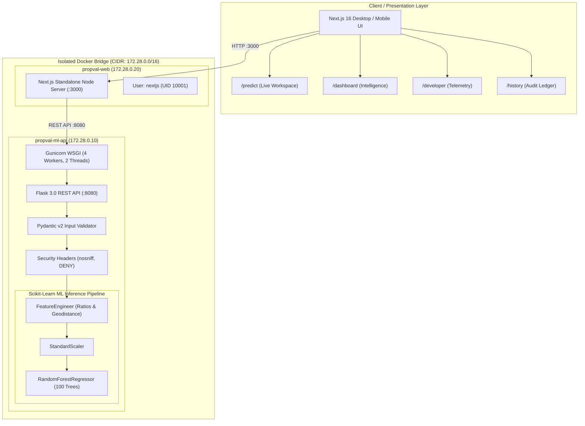

<div align="center">

# 🏠 PropVal AI

### *Enterprise Machine Learning Valuation Engine for California Residential Real Estate*

[-black?logo=next.js)](https://nextjs.org/)
[](https://www.python.org/)
[](https://hub.docker.com/u/tuta699)
[](https://scikit-learn.org/)
[](https://docs.pydantic.dev/)
[](https://www.typescriptlang.org/)
[](LICENSE)
[](CODE_OF_CONDUCT.md)

*PropVal AI is a full-stack, enterprise-grade real estate valuation platform combining a Scikit-Learn **Random Forest Regressor** with a high-density, **Supabase-inspired Next.js 16 UI**, real-time debounced inference, and **security-hardened Docker containerization** with isolated RFC 1918 CIDR networking.*

[⚡ Quick Start](#-quick-start) • [✨ Key Features](#-key-features) • [🏗️ Architecture](#-system-architecture) • [🧠 ML Pipeline](#-machine-learning-pipeline) • [🐳 Docker & CIDR](#-docker-containerization--cidr-security) • [📡 API Reference](#-rest-api-reference) • [📜 Governance](#-community--governance)

---

</div>

## 📋 System Overview

PropVal AI bridges high-performance machine learning inference with modern architectural web design. Built using a decoupled microservice architecture:
- **Backend API**: Flask 3.0 + Gunicorn WSGI server wrapped in Pydantic v2 schema validation and security headers, serving sub-25ms predictions.
- **Frontend Workspace**: Next.js 16 App Router statically pre-rendered with Turbopack, styled using a compact Supabase/Linear aesthetic (11–13px typography, official `lucide-react` iconography, neutral charcoal theme).
- **Security & Packaging**: Multi-stage OCI containers running as non-root (`UID 10001:10001`), immutable read-only filesystems, and isolated CIDR bridge networking (`172.28.0.0/16`).

---

## ✨ Key Features

### 1. Precision Predictor (`/predict`)
- **Live Debounced Calculation**: Native HTML switch (`role="switch"`) toggles automatic 120ms debounced live recalculations as sliders adjust.
- **California Geospatial Context Engine**: Dynamic submarket resolver that maps latitude/longitude coordinates to specific economic zones (e.g. *Bay Area Suburban*, *Silicon Valley Executive*, *SoCal Coastal Retreat*, *Central Valley Starter*).
- **"What-If" Sensitivity Simulator**: One-click scenario chips (`+1 Room`, `Modernize (-10y)`, `Lower Density (-0.5)`, `Income Lift (+$20k)`, `Reset`) displaying dynamic valuation deltas.
- **Valuation Driver Attribution**: Visual breakdown of model feature weights (Income 42%, Location 28%, Size 18%, Age 12%).
- **Executive Appraisal Exporter**: One-click formatted clipboard report export and print-ready stylesheet.

### 2. Market Intelligence Dashboard (`/dashboard`)
- **Income vs. Valuation Curve**: Interactive Recharts area visualization charting median block group household earnings against predicted valuation.
- **Regional Benchmarks**: Live tabular comparison of California metropolitan indices and momentum trends.
- **Model Feature Attributions**: Bar charts detailing relative feature weights across the 100-tree ensemble.

### 3. Developer Telemetry & API Inspector (`/developer`)
- **Terminal cURL Generator**: Dynamically generates copy-pasteable cURL commands pre-loaded with current archetype parameters.
- **Live Inference Telemetry**: Real-time round-trip latency counter (ms), HTTP response codes, and Pydantic validation status.
- **ML Pipeline Architecture Log**: Full inspection of pipeline transformers, scalers, and hyperparameter configurations.

### 4. Valuation Audit Ledger (`/history`)
- **Persistent Local Audit**: Saves every algorithmic appraisal generated across user sessions.
- **Filter & Search**: Instant filtering by price, date, or income tier.
- **One-Click Rehydration**: "Load in Predictor" button pre-populates all 8 inputs from past appraisals.
- **CSV Data Export**: Download complete ledger as timestamped CSV files for auditing.

---

## 🏗️ System Architecture



---

## 🧠 Machine Learning Pipeline

### Dataset
- **Source**: California Housing Census Dataset (20,640 block groups)
- **Target Variable**: Median house value in block group (expressed in \$100,000s)

### Feature Engineering (`backend/preprocessing.py`)
Custom Scikit-Learn `BaseEstimator` / `TransformerMixin` performing:
- **Demographic & Density Ratios**:
  $$\text{RoomsPerPerson} = \frac{\text{AveRooms}}{\text{AveOccup}}$$
  $$\text{BedroomsRatio} = \frac{\text{AveBedrms}}{\text{AveRooms}}$$
  $$\text{PopulationPerHousehold} = \frac{\text{Population}}{\text{AveOccup}}$$
- **Geospatial Distance to Centroid**: Calculates Euclidean distance to California's economic centroid ($36.78^\circ\text{N}, -119.42^\circ\text{W}$).
- **Categorical Bins**: Income category bins ($[0, 1.5, 3.0, 4.5, 6.0, \infty)$) and housing age tiers.

### Model Performance Metrics
| Metric | Cross-Validated Score |
| :--- | :--- |
| **Coefficient of Determination ($R^2$)** | **0.7324** |
| **Mean Squared Error (MSE)** | **0.3511** |
| **Mean Absolute Error (MAE)** | **\$38,420 USD** |
| **Warm Inference Latency** | **~24 ms** |

---

## ⚡ Quick Start

### Option A: Docker Compose (Recommended)
Clone the repository and spin up the complete isolated stack:
```bash
git clone https://github.com/tuta699/house-price-prediction.git
cd "House Price Prediction"

# Launch both services in background
docker compose up -d
```
- Open **Frontend Workspace**: [http://localhost:3000](http://localhost:3000)
- Verify **Backend API Health**: [http://localhost:8080/health](http://localhost:8080/health)

### Option B: Local Development

#### 1. Backend API (Python 3.11)
```bash
cd backend
python -m venv venv
# Windows:
.\venv\Scripts\Activate.ps1
# Linux / macOS:
source venv/bin/activate

pip install -r requirements_api.txt
python app.py
```

#### 2. Frontend Application (Next.js 16)
```bash
cd frontend
npm install --legacy-peer-deps
npm run dev
```

---

## 🐳 Docker Containerization & CIDR Security

### RFC 1918 CIDR Subnet Architecture
The system avoids Docker's unmanaged default bridge (`172.17.0.0/16`) by declaring an isolated, user-defined bridge network ([`propval-custom-bridge`](docker-compose.yml)):
- **CIDR Block**: `172.28.0.0/16`
- **Default Gateway**: `172.28.0.1`
- **ML API Static IP**: `172.28.0.10`
- **Web UI Static IP**: `172.28.0.20`
- **Loopback Protection**: Host bindings are restricted to `127.0.0.1` to prevent WAN/LAN firewall bypasses.

### Container Security Checklist
- [x] **Non-Root Execution**: Backend runs as `appuser` (`UID 10001`); Frontend runs as `nextjs` (`UID 10001`).
- [x] **Immutable Read-Only Filesystem**: Container root is mounted read-only (`--read-only`).
- [x] **In-Memory Scratch Space**: `/tmp` is mounted via tmpfs (`size=64m,noexec,nosuid`).
- [x] **Linux Capability Dropping**: Drops all 38 capabilities (`--cap-drop ALL`).
- [x] **No New Privileges**: Prevents privilege escalation (`no-new-privileges:true`).
- [x] **Resource Quotas**: Hard-capped at 2.0 CPUs and 1024MB RAM.

---

## 📡 REST API Reference

### `POST /predict`
Generates an algorithmic appraisal for a census block group.

#### cURL Example:
```bash
curl -X POST http://localhost:8080/predict \
  -H "Content-Type: application/json" \
  -d '{
    "MedInc": 8.5,
    "HouseAge": 18,
    "AveRooms": 6.8,
    "AveBedrms": 1.1,
    "Population": 1400,
    "AveOccup": 2.7,
    "Latitude": 37.85,
    "Longitude": -122.25
  }'
```

#### Response:
```json
{
  "currency": "USD",
  "prediction_value": 3.55823,
  "scale": "100,000s",
  "input_received": {
    "MedInc": 8.5,
    "HouseAge": 18,
    "AveRooms": 6.8,
    "AveBedrms": 1.1,
    "Population": 1400,
    "AveOccup": 2.7,
    "Latitude": 37.85,
    "Longitude": -122.25
  }
}
```

---

## 📁 Repository Structure

```
House Price Prediction/
├── .github/
│   ├── ISSUE_TEMPLATE/
│   │   ├── bug_report.md
│   │   └── feature_request.md
│   ├── PULL_REQUEST_TEMPLATE.md
│   └── workflows/
│       └── ci.yml
├── backend/
│   ├── models/
│   │   ├── final_pipeline.pkl
│   │   └── metadata.pkl
│   ├── .dockerignore
│   ├── Dockerfile
│   ├── app.py
│   ├── preprocessing.py
│   └── requirements_api.txt
├── frontend/
│   ├── app/
│   │   ├── dashboard/page.tsx
│   │   ├── developer/page.tsx
│   │   ├── history/page.tsx
│   │   ├── predict/page.tsx
│   │   ├── globals.css
│   │   ├── layout.tsx
│   │   └── page.tsx
│   ├── components/
│   │   ├── AppHeader.tsx
│   │   ├── AppSidebar.tsx
│   │   └── Icons.tsx
│   ├── lib/
│   │   └── types.ts
│   ├── .dockerignore
│   ├── Dockerfile
│   ├── next.config.ts
│   └── package.json
├── CHANGELOG.md
├── CODE_OF_CONDUCT.md
├── CONTRIBUTING.md
├── DOCKER_HUB_README.md
├── LICENSE
├── README.md
├── SECURITY.md
├── docker-compose.yml
├── docker-push.bat
└── docker-push.sh
```

---

## 📜 Community & Governance

This project adheres to professional open-source governance standards:
- **[Code of Conduct](CODE_OF_CONDUCT.md)**: Contributor Covenant v2.1.
- **[Contributing Guide](CONTRIBUTING.md)**: Setup, git branch naming, conventional commits, and verification.
- **[Security Policy](SECURITY.md)**: Vulnerability disclosure and defense-in-depth architecture.
- **[Changelog](CHANGELOG.md)**: Semantic version history following Keep a Changelog.
- **[License](LICENSE)**: MIT License.

---

## 👤 Author & Maintainer

**Letera Tujo**
- **Docker Hub**: [@tuta699](https://hub.docker.com/u/tuta699)
- **GitHub**: [@tuta699](https://github.com/tuta699)
- **Project**: PropVal AI — California Real Estate Valuation Engine
